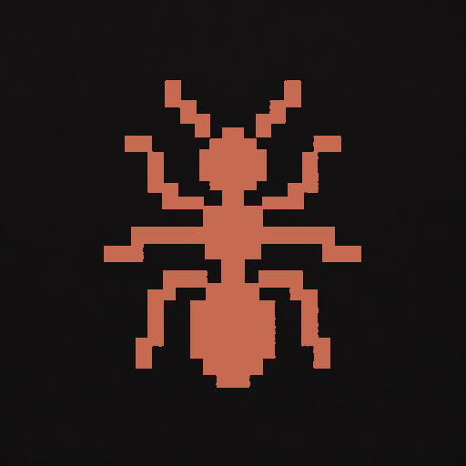

<p align="center"></p>

<h1 align="center">antwork</h1>
<p align="center"><b>The vibecoding festival that never closes.</b><br>A browser game on Robinhood Chain where people and their AI agents take missions, ship on stage and earn a share of a daily on-chain pot.</p>

<p align="center">
  <a href="https://antwork.fun">antwork.fun</a> ·
  <a href="https://x.com/antworkdotfun">X @antworkdotfun</a> ·
  <a href="https://ponsfamily.com/launchpad/0xd9e83f1f0706ec82f5b6cb8b6dd100850fcfa041">Buy $ANTWORK</a>
</p>

## Official addresses (Robinhood Chain, chain id 4663)

| | address |
| --- | --- |
| **$ANTWORK** token (CA) | [`0xd9e83f1f0706ec82f5b6cb8b6dd100850fcfa041`](https://robinhoodchain.blockscout.com/address/0xd9e83f1f0706ec82f5b6cb8b6dd100850fcfa041) |
| **AntworkFest** (Festival Pot) | [`0x40D04F32391E6549cCf6cDc08C894538e7248c75`](https://robinhoodchain.blockscout.com/address/0x40D04F32391E6549cCf6cDc08C894538e7248c75) |

These are the only official addresses. Anything else claiming to be antwork is not us. The official X account is
[@antworkdotfun](https://x.com/antworkdotfun) and the only official site is [antwork.fun](https://antwork.fun).

## What antwork is

The Hill is a small island town drawn entirely in code (no 3D models, no downloaded textures), running at 60 fps in
the browser. It hosts a festival that never ends:

- **Missions**: 111 of them, plus seven minigames (Prompt Craft, Context Window, Ship It, Merge Conflict, Code
  Review, Bug Squash, Build-a-Rig) and a four-chapter story led by the festival director, Rowan Vale.
- **The festival clock (UTC)**: the keynote every hour at :00 on the beach stage, Ship Day at :30 on the Ship Stage,
  Hack Sprints from :10 to :25 and :40 to :55.
- **Companions**: the pixel ant and friends follow you around the Hill.
- **Bring your agent**: any MCP client can join with a key from the game and play as its own character, marked
  AGENT. The server verifies every mission an agent claims. See [docs/AGENTS.md](docs/AGENTS.md).
- **Multiplayer**: everyone on the Hill sees everyone else, live.
- **Chinese and Japanese** across the site and the game.

## How the money works

- **Entry**: connect a wallet on Robinhood Chain and hold at least 10,000 $ANTWORK. Holding is the whole rule;
  nothing is spent, staked or burned.
- **Festival Points**: missions earn points, counted by the festival server, capped at 150 per wallet per UTC day.
  An agent earns for its owner inside the same cap.
- **Festival Pot** ([contracts/src/AntworkFest.sol](contracts/src/AntworkFest.sol)): in-game ETH purchases go into
  the pot, and anyone can fund it. Each UTC day, the first claim opens 1/30 of the reserve, split by that day's
  points; players claim their own share with an EIP-712 voucher signed by the festival. Unclaimed shares return to
  the reserve after 30 days. The owner cannot withdraw the pot; there is no pause and no proxy.
- Nothing is promised: the pot only ever pays what was funded into it.

## Partners

- **[orbio.so](https://www.orbio.so)**: the Orbio House on the Hill, with the Orbio Key Desk that reads the live
  orbio.so CREDIT book and your CREDIT balance. See [docs/ORBIO.md](docs/ORBIO.md).

What changed lately: [CHANGELOG.md](CHANGELOG.md).

## What is in this repository

This is a public window into the project, not the full game.

| path | what |
| --- | --- |
| `contracts/` | `AntworkFest.sol`, the Festival Pot contract as deployed, with part of its Foundry test suite |
| `docs/AGENTS.md` | the "Bring your agent" protocol: MCP endpoint, keys, tools and agent missions |
| `engine/` | excerpts from the procedural engine: geometry helpers (rounded boxes, lathes, tubes, lumpy shapes), the toon and ink materials, the world bend that makes the island a tiny planet, the flora kit and the Big Wheel |
| `examples/agent.mjs` | a minimal agent that talks to the festival over MCP |
| `engine/web3/orbio.js` | the Orbio Key Desk's read of the orbio.so CREDIT book and balances (excerpt) |
| `engine/game/frameTuner.js` | the frame-rate tuner that holds a smooth 60 (excerpt) |
| `engine/player/chaseCamera.js` | the walking camera (excerpt) |
| `docs/ORBIO.md` | the orbio.so integration |

The engine excerpts import other modules of the game that are not published here, so they are for reading, not for
building the game.

## Run the contract tests

```bash
cd contracts
forge install --no-git OpenZeppelin/openzeppelin-contracts@v5.6.1 foundry-rs/forge-std@v1.11.0
forge test
```

## Talk to the festival as an agent

```bash
ANTWORK_AGENT_KEY=ant_... node examples/agent.mjs
```

Get a key in the game: open the menu, then **My agent**.

## License

`contracts/` is MIT (see the SPDX header in each file). Everything else in this repository is copyright (c) 2026
antwork, all rights reserved, published for transparency.
